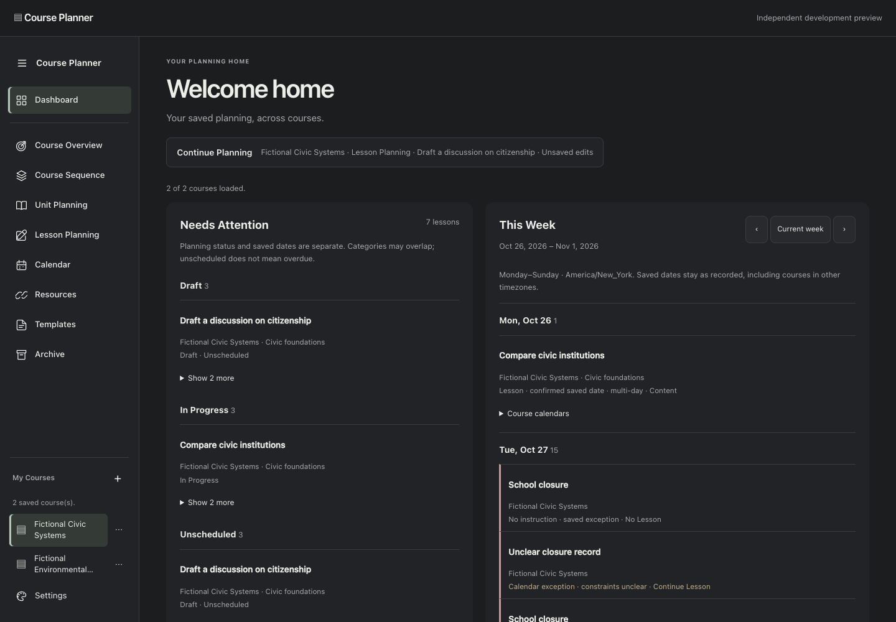
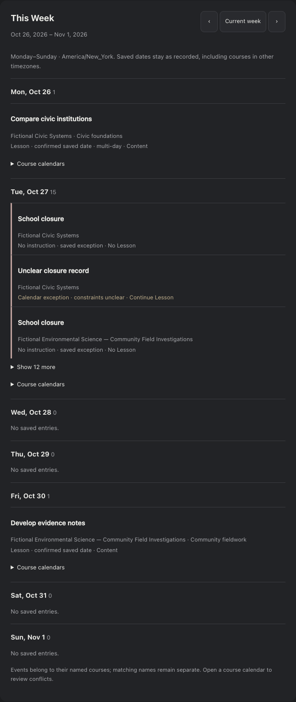

# Dashboard v0.2 — Issue #10 / DEC-094

## Engineering decision before implementation

Verified PR #9 and origin at `0c5d4e745751720d210a286135232ea4473b458a`.
New follow-up branch: `codex/dashboard-needs-attention-week`, stacked on
`codex/home-sidebar-navigation`. PR #6 and PR #9 stay unmerged/draft; PR #7 is excluded.
Read the current canonical product record through the verified collaboration
connection, including DEC-094 (revision AHj4eMR0gxMugGtpzxDcH45yxA3M2aveKdwVOBz7M-Rq69RzwaHmkRjNtpnlKFaTy_ySbkVh_m0mH_l2k39o3T5BKZR_Lm9do3dWhKeoVcI).

Implement Needs Attention first, This Week second, then Home composition and
Continue Planning. Pure projections in dashboard-model.js, page-memory loading and
rendering in dashboard.js. Reuse bounded, paginated reads and the existing signed-in
client. Fetch only course identity/timezone, unit context/archive metadata, lesson
identity/title/status/saved dates/type/archive fields and saved event labels/effects.
Each course is rechecked against the account owner. No authored lesson text cache.
Account/list/week generations and course request versions must reject late replies.
Keep partial/error/loading states distinct from a genuinely empty saved course.

Draft and In Progress are saved statuses; unscheduled is a separate date fact.
Categories overlap, with a unique-lesson summary and explicit overlap explanation.
Never invent Needs Revision, due dates, urgency scores or scheduling placements.

The agenda uses Monday–Sunday in the browser's resolved timezone, with an explicit
UTC fallback for invalid browser zones. Course/database DATE strings stay unchanged;
no timezone conversion of lesson or exception dates. Invalid saved dates and event
constraints remain disclosed as uncertain. Per-course exceptions retain their own
IDs and attribution; no shared-school identity is available, so no deduplication
by title/date. Exact saved Assessment type is identifiable; other raw types remain
lesson labels. Dense-day lists are bounded with course-calendar access to the rest.

Home deep links recheck course authorization and stable record IDs. Source drafts
are cached by the existing per-course context mechanism. A different target view
must not replace a dirty target editor: block with an actionable message rather
than silently discarding. Exact already-open dirty lesson links may resume its
actual DOM. Continue Planning always reveals the existing workspace without rebuild.

Scope: dashboard modules, Home markup/styles, auth read coordination and minimal
workspace deep-link/context reporting; tests and review artifacts. Existing save,
conflict, archive, backup, restore and scheduling engines stay intact. Course cards
remain secondary and independently counted; Home Create is for an empty account.
No migration, permission/Auth setting, marketing/Sheet/Apps Script change, widget
engine, tab/split feature, merge or production promotion. Rollback to PR #9's head
requires no data rollback. No new Supabase email; synthetic browser fixtures only.

## Resulting behavior and limits

Needs Attention was implemented and pure-tested before adding the weekly projection.
Its top count is unique active lessons across the separate Draft, In Progress and
Unscheduled categories. Missing/null or empty saved arrays are unscheduled; malformed
nonempty arrays remain a data-quality note, not fabricated dates or lateness.
Lists initially show one lesson per category and up to 20 through disclosure, with
course access for the rest. This Week initially shows three entries per date, then
up to 20 via disclosure and links to each affected course's Calendar. Totals are
computed before truncation. Events sort before exact saved Assessment types, then
other lessons, with course/sequence/stable-ID ordering. Multiday lessons appear on
each valid unique saved date. Hypothetical Build Schedule results are never inputs.

The existing event normalizer determines uncertainty. Ambiguous records are labeled
constraints unclear; no global closure identity is invented. Two course-specific
School closure records on the same date remain two attributed events. Calendar
conflicts are not resolved on Home; the saved course Calendar remains available.
The dashboard's Mon–Sun boundary deliberately does not alter the existing calendar's
Sunday-based helper. Prior/next/current week controls refetch bounded projections.

Reads use the existing pilot limits (100 dashboard courses, 200 units, 2,000 lessons,
1,000 events per course; pagination batches of 500 and three course workers). A
course/relationship read failure is explicit and omitted from the loaded totals.
An event-only failure preserves lesson/status results and marks the agenda partial.
All-course failure offers Retry and never claims a zero-record account. Retry checks
the current cached Auth session; it does not send email. No authored objective,
question, lesson notes or other long-form editor fields are read for the dashboard.
Transient source rows are released after bounded projections; only current-week
entries and bounded attention items remain in page memory until refresh/sign-out.

Continue Planning reports the actual selected course/view and saved lesson identity
when an inspector is open, plus unsaved state. It reveals retained editor DOM.
Create Course is prominent only in Home's empty-account state, with My Courses +
retained for other accounts. Existing independent count cards remain below the two
primary dashboard panels. Default tab/split and persistent-icon boundaries remain
those of PR #9.

## Personally executed verification

- **107 Node tests pass**, no failures/skips: all previous tests plus attention,
  civil-week/DST/zone fallback, archives, multiday/invalid dates, same-date independent
  events, ambiguity, owner boundary, empty/large datasets, metadata-only paginated
  reads, event partial failure, late-account replies and newer-course-result wins.
- **749 full app Chrome browser checks pass**, zero uncaught errors, at desktop
  1440×1000 and mobile 390×1000 (retaining prior focused 320px card checks).
- Dashboard fixture: two authorized courses in different zones plus an inaccessible
  foreign owner; 7 distinct attention lessons across overlapping counts of 3/3/3;
  15 Tuesday entries including two same-title per-course closures and an ambiguous
  closure, multiday lessons and an assessment. Archived rows are absent.
- Browser checks cover exact stable-ID lesson/Calendar links; Enter entry and focus;
  retained editor DOM, draft and pane scroll through Continue; source and destination
  dirty drafts across courses; blocked conflicting destination view; empty next week;
  course partial/all failures; retry; event-only partial data; no page overflow;
  unchanged full saved-record serialization/zero writes during navigation; loading
  without fabricated zeros; late replies after sign-out; and next-account isolation.
- The full suite retains ordinary Save/Reload/conflicts, Essential/Guiding Question
  relationships, JSON restore/export, ZIP backup, archived recovery records, saved
  Month/Week, Build Schedule and Event/Move/Keep preview and inspector regressions.
- **265 unchanged marketing/demo checks pass**, 42 screenshots, zero browser errors.
- `git diff --check` passes; no separate build/lint/typecheck script exists.

All local logs/full evidence are ignored under `app/reviews/dashboard-v02/`.
Curated images contain only deterministic synthetic fixture data. Before images
are PR #9's prior synthetic Home; after images illustrate the new mixed-course
Dashboard fixture rather than implying a real owner's records were read.

[Before desktop](dashboard-v02/before-desktop.png) ·
[Before mobile](dashboard-v02/before-mobile.png) ·
[After desktop](dashboard-v02/desktop-home.png) ·
[After mobile](dashboard-v02/mobile-home.png) ·
[Empty week](dashboard-v02/empty-week.png) ·
[Empty account](dashboard-v02/empty-account.png)

## Outstanding acceptance gates — separately reported

**Hosted:** owner visual approval and real signed-in behavior on the new preview
remain open. No Supabase sign-in email was requested. Initial browser testing used
synthetic owner-scoped clients, not live saved records.

**Security:** genuine independent-account unauthorized write/insert RLS verification
is still open. Synthetic owner filters and stale-read tests do not establish live
RLS correctness. No schema/permissions/Auth configuration or sharing grant changed.

**Integration:** review dependencies #6 → #9 → this follow-up separately before any
merge. No merge or production promotion was performed. Marketing source, config,
backup and scheduling engines, Google Sheet and Apps Script stay unchanged. Course
contexts/icons remain page-memory, not durable recovery or cross-device state.
