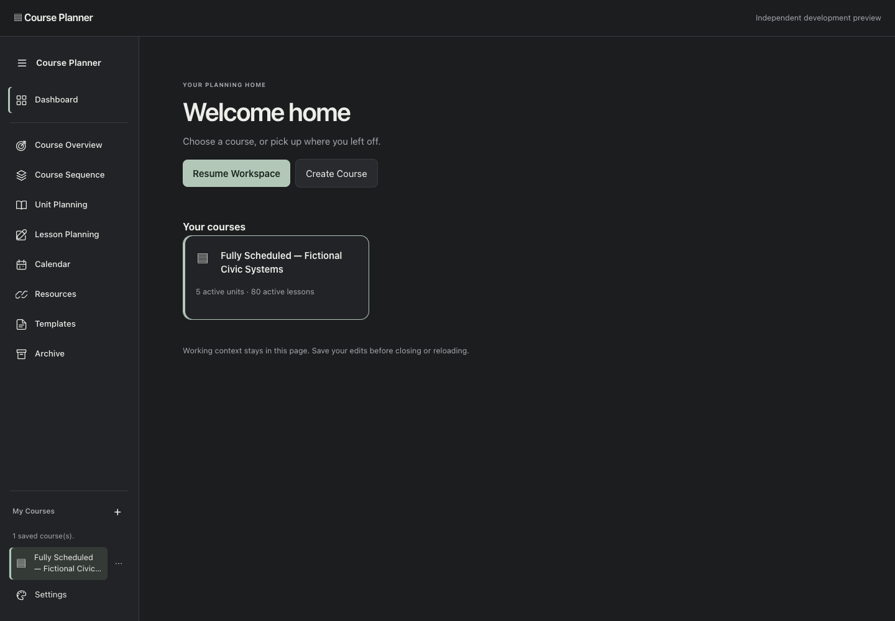
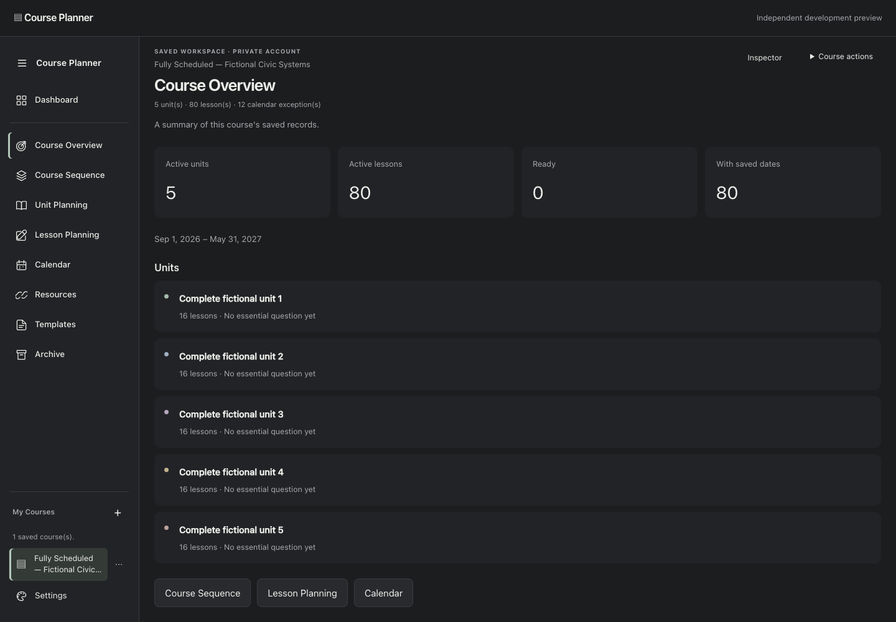
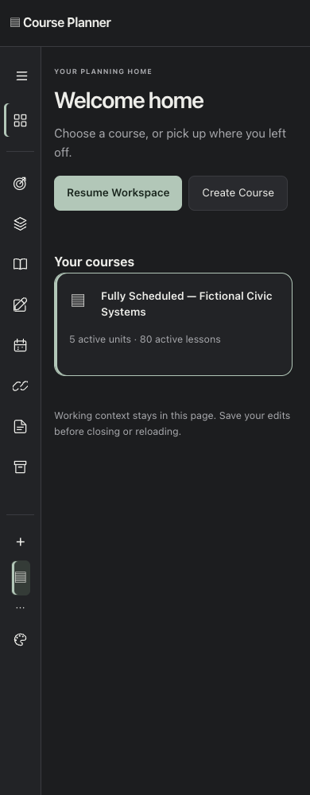
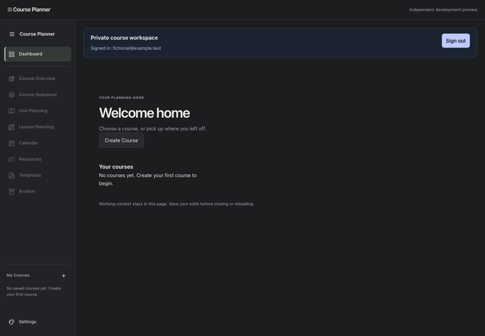
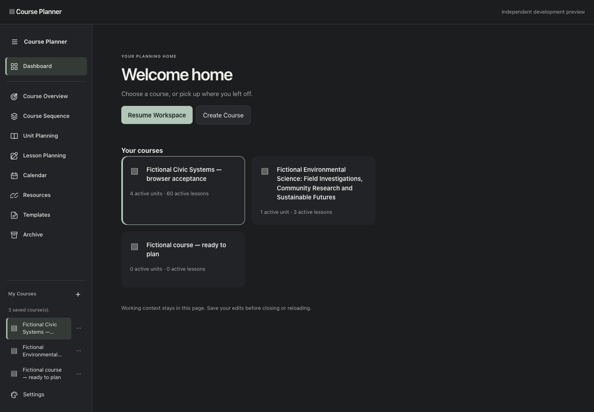
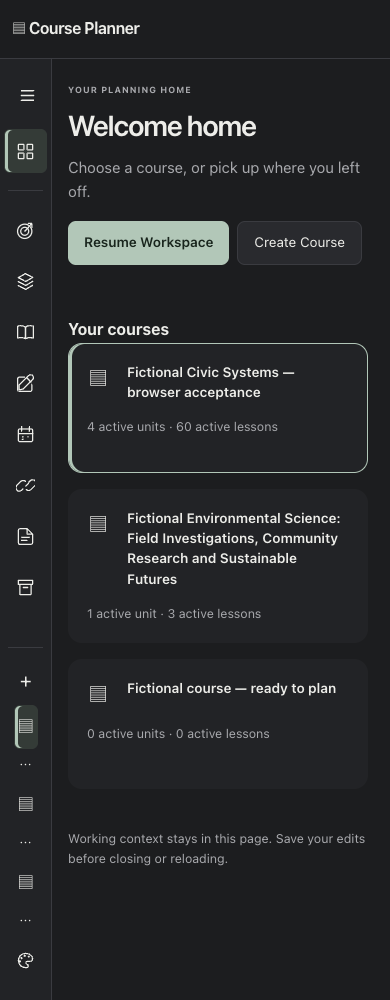
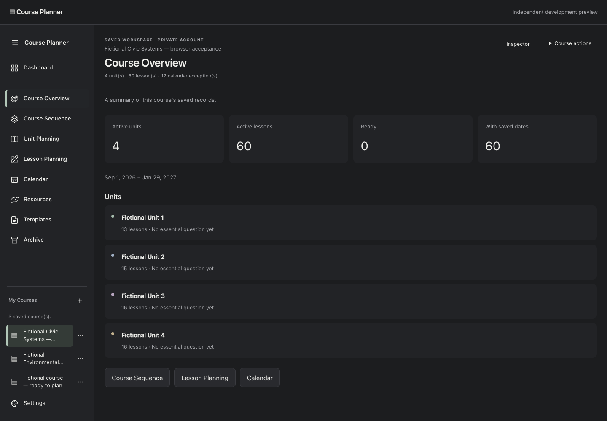

# Home/navigation milestone — engineering decision record

## Reconciliation before implementation (October 27, 2026)

Product authority: Course Planner — Canonical Product & Development Record,
read through the verified collaboration connection, revision
`AHj4eMQBYmarSQ_JNoWkpcf18538sHyhnroAT5IR5T2ta_O6twvFrHL6oSBoo32bdPG5B-HR_Wtvdf__bUhMIhrx2P5rB60rer5gbqldTuo`.
DEC-036–055 and DEC-083–092 govern; Issue #8 scopes this increment.

Verified origin and remote heads before editing:
- `pilot/app-foundation`: `54870b700564cfa65ebc9087fbfb8e330e1a6fcb`.
- Draft #6, `codex/build-schedule-outlook`: `e578da69227fae1954132dee0ab17feff6629c62`.
- Draft #7, `feature/home-shell-first-pass-2026-10-27`: `1276279e324e0a02f7811db1594412d8e8592a7d`.

Use #6 as the single source and create `codex/home-sidebar-navigation` from its
exact tested head. Leave both existing PRs/branches untouched. #7's independent
`.private-shell` would duplicate #6's sidebar and compete for workspace visibility.
Its auth-owned overview is a placeholder, its course switch discards drafts after
confirmation, and its create path can insert before checking draft protection.
Reuse the Home/Overview distinction, not that patch. The new PR will be stacked on
#6 for a review limited to this milestone; integration into the pilot must review
#6 first and then retarget this PR. Never merge #6 and #7 independently.

Expected modules: `index.html`, `workspace-shell.js`, `workspace.css`,
`private-workspace.js`, `auth.js`, Node/browser tests and this record. Preserve the
existing three-pane DOM/editor, inspector, calendar, scheduling preview and backup
modules. Home must hide the workspace without rebuilding it. Course switching
needs account-scoped page-memory contexts with retained DOM/drafts/scroll and a
fresh authorized read before restoring one. Pending saves must block switching.
Auth refresh must not reset Home, a draft, or another account's context.

## Boundaries and rollback

This increment uses the existing single central destination. Overview and the
three placeholders follow that destination path. There is no existing tab bar,
Open in New Tab action, group or split implementation to preserve; those remain
M2. Do not portray a single destination as completed multi-tab support.

Curated icon choices are page-memory presentation only, cleared on account change
or reload and explicitly labeled. They never use name/color as identity. Durable
icons require a separately reviewed nullable allowlisted course icon field,
owner-only update/validation, migration, export/restore compatibility and tests;
no migration or undocumented database field belongs here.

No scheduling writes, RLS/schema/Auth configuration, Google Sheet/Apps Script,
marketing source or production change. No cross-device/durable draft recovery is
claimed. Existing unload/sign-out protection must include background drafts.
Rollback: stop using the new preview/branch and return to PR #6's unchanged head.
No data rollback or migration is needed. Existing untracked review artifacts stay
untouched; local private evidence remains under Git-ignored `app/reviews/`.

## Verification and delivery

Results and known limits will be recorded here after automated and browser runs.
Owner visual acceptance is required before any merge or production promotion.

## Original milestone behavior and checks (98ca9b6)

Home hides, rather than replaces, the existing central DOM; Resume restores focus
without scrolling. A mobile inspector Home button provides an exit while retaining
a dirty form. Sidebar course switching keeps the previous course's actual editor
nodes, form values, inspector state, date selection, proposals and scroll in an
account-scoped in-memory map. Each restore first reads the requested course and
children through the existing client and validates its owner. Cached revisions
stay attached to their drafts so optimistic conflict checks still apply. Clean
cached views are retained too; Reload saved data explicitly refreshes them.

Ordinary destination changes retain the existing discard confirmation. A save in
flight blocks view/course switching; Home can still hide it safely. Sign-out,
backup and unload checks include background course drafts. Direct account changes
and sign-out clear all contexts and icon choices. Course creation uses the same
owner-scoped insert and retains the old course's draft/context; account checks
also prevent stale create/restore callbacks from opening another user's course.

Personally executed on the original milestone source at `98ca9b6`:
- `cd app && node --test tests/*.test.mjs`: **92 pass**, no failures/skips.
- `node app/tests/calendar.browser.mjs` with bundled Playwright and local Chrome:
  **654 pass**, zero uncaught browser errors, desktop 1440×1000 and mobile 390×1000.
  These runs replace the SDK at its network boundary with an owner-scoped synthetic
  client; they do not use real credentials or write to Supabase.
- Includes startup Home/empty account/Create via +; Overview; all eight destinations;
  active labels/icons; keyboard toggle and exact stationary toggle bounds; responsive
  transitions; Home/Resume actual calendar-node/scroll identity; retained dirty input
  nodes across Home, auth refresh and two courses; authorization-denied target;
  save-in-flight switch rejection/failed-save draft retention; background-draft
  sign-out guard; sign-out/in and direct account change; no navigation mutations
  via before/after saved-record serialization. Existing authoring/Save/Reload,
  conflicts, archives, JSON restore, ZIP downloads and read-only scheduling scenarios
  remain in the full suite.
- `python3 app/tests/verify-demo-regression.py`: **265 pass**, 42 screenshots,
  zero browser errors. The original public-demo assertions and marketing assets
  are unchanged; output uses an isolated ignored project-local directory.
- `git diff --check`: passes. No build/lint/typecheck script exists.

Full logs and all captures are local, ignored evidence under
`app/reviews/home-navigation/`. The four curated screenshots alongside this
record contain exclusively the deterministic fictional browser fixtures, including
the reserved `fictional@example.test` test identity. They are safe review assets;
no live account screenshots, snapshots, record/owner IDs or credentials are added.

### Review screenshots

### Remaining acceptance boundaries

No real Supabase row or live authenticated browser session was used by the local
suite. Live sign-in on the new preview origin, real cross-account write/insert
isolation and owner visual acceptance remain explicit hosted acceptance items;
local synthetic access tests do not establish production RLS correctness. Prior
milestones' live evidence is historical, not a rerun on this branch. This change
introduces no schema/RLS/Auth configuration or SDK-version changes.

No durable workspace recovery, tabs/groups/splits, widget engine, persistent icon
choice or collaboration grants are claimed. Course Overview is wired through the
same planning destination renderer so it can participate in M2's future selected-
tab and Open in New Tab behavior; those controls do not yet exist in the baseline.

## DEC-093 refinement — compact summary cards (October 27, 2026)

Implements the complete owner review at
https://github.com/jmichaeldinardo-spec/Course-Planner/pull/9#issuecomment-6459579355.
Read the current CPD through the verified collaboration connection; DEC-093 selects
Option B, compact summary cards. This design decision does not approve the final UX
or merging. PR #9 stays on its existing PR #6-derived branch and remains draft.

### Implementation and data semantics

Home uses bounded cards (up to 300px) in a responsive grid, with a soft neutral
surface, retained course icon/name and active selection. The whole card is a native
button, keyboard/touch accessible. Cards show independent active unit/lesson facts.
`course-summary.js` reads only IDs, relationships and archive flags through the
existing signed-in RLS client, scoped by the authorized course ID, ordered by ID,
and paginated in batches of 500. No lesson text or second curriculum dataset is
retained. Three workers bound concurrent course loading. Per-course request versions
and the existing account/list generation prevent stale replies from publishing.
Labels update in place without moving focus or rebuilding working editors.

Counts follow `activeCalendarRecords`: an archived lesson is omitted, and all
children of an archived unit are omitted even if not individually archived. Every
course loads its own metadata. Incomplete/failed relationships or reads show Summary
unavailable, never fake zero counts; the card remains a working entry. Reads beyond
the existing 200-unit/2,000-lesson pilot bounds also show unavailable. A separately
paginated refresh after course load/save keeps editor reads capped by the API from
replacing an accurate Home count (tested with 1,201 lessons).

**Last edited is intentionally omitted.** The available `courses.updated_at` records
a course-row timestamp, not a guaranteed latest edit across units, lessons and
calendar records. Missing child timestamps cannot be invented, and this refinement
adds no timestamp contract, trigger or schema field. This follows the review's
explicit instruction to omit unreliable last-edited information. Saved term dates
in Overview are formatted as readable civil dates and are not edit timestamps.

Overview now passes its active records into the unit-list renderer. Its header,
summary totals, visible units and per-unit lesson counts agree. The default renderer
inputs for Unit Planning and all other editors remain their original records, with
unit color associations intact. Low-risk polish limits sidebar titles to two visual
lines (full accessible name/title retained), shortens repeated status copy and gives
Overview unit rows soft panels. No new navigation, widget or tab architecture.

### Final personally executed verification

- **97 Node tests pass**, no failures/skips (`node --test tests/*.test.mjs`). Five
  additional summary tests cover archive relationships, immutability, empty/singular
  counts, timestamp omission, course-only metadata reads, 1,201-lesson pagination,
  failures, pilot size limits and cross-course/missing-parent rejection.
- **695 full app browser checks pass**, zero uncaught errors, with synthetic data
  and the real application modules at 1440px/390px plus focused 320px/760px checks.
  All original navigation, dirty editor, save/reload/conflict, import/export, ZIP,
  calendar, Build Schedule and mobile inspector regressions remain in the suite.
- New browser coverage: bounded one-course layout; differing per-course counts;
  zero records; long names; missing/course-only timestamps; whole-card Enter entry;
  active course; archived unit with children and independently archived lesson;
  Overview header/list/count consistency; other editor views unchanged; unit drafts
  across Home/summary refresh/course switches; failed summary reads/clickable cards;
  1,201-lesson counts despite capped editor reads; stale reply after sign-out; and
  unchanged saved-record serialization/zero writes during navigation.
- **265 marketing/demo checks pass**, 42 screenshots, zero browser errors. Marketing
  source and original assertions remain unchanged.
- `git diff --check` passes. No build/lint/typecheck script exists.

Logs/full evidence: ignored `app/reviews/dec-093/`. All curated screenshots contain
only deterministic synthetic records. Before images preserve the original `98ca9b6`
render; the single-course before/after screenshots use the same original fixture.

[Before desktop Home](home-navigation/before-dec-093/desktop-home.png) ·
[After desktop Home](home-navigation/desktop-home.png) ·
[Before mobile Home](home-navigation/before-dec-093/mobile-home.png) ·
[After mobile Home](home-navigation/mobile-home.png) ·
[Before Overview](home-navigation/before-dec-093/desktop-overview.png) ·
[After Overview](home-navigation/desktop-overview.png)

### Acceptance gates retained

Owner visual acceptance and hosted signed-in acceptance remain open. Synthetic
account tests do not establish real cross-account write/insert RLS correctness.
No Supabase email was requested; the owner is rate-limited. No live saved rows were
used or changed. No schemas, permissions, Auth settings, SDK version, marketing
source, Google Sheet, Apps Script, scheduling engine or backup implementation changed.
Page-memory icons/workspaces and M2 tab/split deferrals remain unchanged. No merge
or production promotion is authorized or performed. Rollback of this refinement is
the original PR #9 head `98ca9b6`; no data rollback is necessary.
