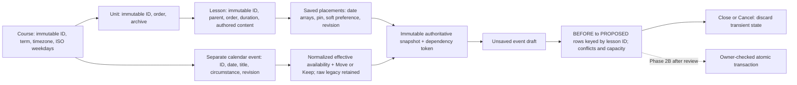

# Event + Scheduling Effect — Phase 2A design for review

Source: Issue #3; CPD tabs 03 and 08, DEC-027 (October 26, 2026), read through the
verified collaboration account. Base: `pilot/app-foundation` at `6b5c514`.
This document specifies a **preview-only** implementation. No migration, scheduler
RPC, scheduling write or enabled Apply/Confirm action belongs to 2A.

## Domain and state

The only saved lesson collection remains the authenticated workspace's records.
The engine returns placement projections/IDs, not editable copies of lesson content.
Archived lessons and lessons under archived same-course units are excluded before
scheduling; full records remain in editors and v1 exports/backups. Orphan active
lessons are input errors. Event records are not numbered lessons and never count
as both replacement instruction and ordinary lesson demand.

A preview binds to an exact canonical serialization of the input snapshot, including
record identities, archive flags, authored content, revisions, term, availability
and all events. This is a local equality token, **not** an authorization token or
server freshness guarantee. Reloading changed records invalidates an open proposal.
Unseen changes in another tab cannot be certified locally; 2B must re-read/lock all
dependencies. Closing, navigating away or changing courses discards the draft. The
preview form does not set the lesson/unit authoring dirty flag or use localStorage.

## Approved behavior versus bounded implementation recommendations

**Approved:** separate Event and Effect; Move/Keep; constraints outrank defaults;
closed dates cannot Keep instruction; legacy mappings below; distinct hard pins
and soft preferences; preserve IDs/order/content; show complete impact; no writes
before review/confirmation. Extend is a deferred concept, not an enabled effect.

**2A recommendations requiring product review before writes:** one ordinary
lesson-day per eligible course date; full-day duration represented by an integer;
rightward ripple only, retaining existing gaps/anchors when possible, rather than
compressing the whole course back to term start. Existing fully scheduled,
consistent dates are the baseline. Unanchored unscheduled lessons, incomplete
saved duration, overlaps, order inversions, missing revisions and unknown time
allocations block computation instead of silently repairing the course.

The proposed multi-day Move policy retains unaffected earlier slots and displaces
blocked/later slots to subsequent eligible dates; it does not add duration (Extend)
or move a whole lesson block back to its start. This continuity recommendation
requires explicit product review before writes.

Multi-day duration uses every required eligible date; a proposed lesson is either
fully allocated or explicitly unplaceable, never quietly shortened. Existing
multi-day gaps that skip an otherwise eligible date require continuity clarification.
For pinned lessons, 2A protects the **entire saved date array**. This conservative
protection does not settle whether future pins protect only starts or whole spans.
A displacement that cannot fit before a later pin is blocked; pins never move.
Soft preferences do not reserve slots, reorder lessons or become implicit pins;
unmet preferences generate an explanation. They are not a separate move command.

## Event availability, defaults and overrides

These are full-course-date policies, not a model of periods/minutes. The form asks
“What is happening?” and separately “What happens to the lesson?”. Defaults remain
visible, editable suggestions; nothing is automatically saved.

| Circumstance | Suggested availability/effect | Permitted override / teacher message |
| --- | --- | --- |
| Full closure | Closed / Move | Keep disabled: “This date is closed; Keep cannot restore instruction.” |
| Testing | Occupied / Move | Teacher may explicitly classify as instructional annotation and choose Keep if ordinary instruction remains possible. Keep on occupied dates is forbidden. |
| Shortened periods | Instructional annotation / Keep | Move may reserve this date for the event instead. Keep preserves dates; it does not claim sufficient minutes or allocate extra time. |
| Assembly, field trip, other | Unknown / unresolved | Teacher must clarify closed, occupied or instructional. “Clarify whether ordinary instruction is available.” |
| Partial-time allocation | Unknown / blocked | “Partial-day time allocation is not designed yet; no placement is calculated.” |

Existing saved full closures remain hard constraints even when changing an event's
type/default. Reopening a closure requires a separately reviewed reclassification
policy; changing the date of a still-closed Move event can be previewed.

A Move event reserves its date against ordinary placement even when the date could
otherwise teach; Keep annotates an instructional date without consuming a second
lesson slot. Full closure is an independent hard constraint. Another closure or
Move event on that date cannot be bypassed by Keep. Multiple occupied activities
claiming one ordinary period are blocked for conflict review, not double counted.
Compatible closures combine into one unavailable date. New events outside term,
unknown effects, Extend and reserved-flex/time-allocation requests are blocked.
Weekend events can remain visible but do not create teaching capacity.

### Legacy normalization (no destructive backfill)

| Raw stored effect | Effective availability | Effective effect |
| --- | --- | --- |
| No Lesson | Closed / no normal instruction | Move |
| Replace Lesson | Occupied by alternate activity | Move |
| Continue Lesson | Flagged instructional date | Keep |

Retain raw `effect`, `event_type`, title, notes, ID and revision. Unknown subtype is
labeled “legacy subtype unspecified — clarify when editing”; do not manufacture
an assembly, test, holiday or replacement lesson. A contradictory explicit closure
and Keep is a blocking event conflict. Unknown raw effects stay uncertain. The
Phase 1 saved diagnostics now use these approved effective mappings; earlier
statements that Replace/Continue were universally uncertain are superseded by
DEC-027, not by new persistence fields.

## Preview contract and failure behavior

Input: authoritative course/units/lessons/exceptions snapshot, unsaved event choice,
and expected snapshot token captured when opening the form. Change targets a stable
existing event ID; add has a transient event identity, never a lesson ID.

Output: event BEFORE/PROPOSED and effective values/default origin; all active lesson
BEFORE/PROPOSED arrays keyed by stable ID, affected IDs, protected commitments;
active/excluded totals, date availability, reserved/consumed capacity and unmet
work; blocking conflicts versus informational/soft warnings. `null` proposed dates
mean “not assessed because input/policy is unresolved”; `[]` means explicitly
unplaceable. Both are labeled in the UI, never presented as a successful placement.
The original saved calendar continues to display only saved facts.

Base validation precedes ripple calculation. A fully blocked input still returns
all BEFORE rows and the proposed event, with explicit reasons and no invented
placements. For a valid baseline, an unpinned lesson keeps its original start as a
lower bound and shifts only when unavailable dates or preceding displacement require
it. Allocate all full-day slots before the next hard commitment. A failure is shown
with its unmet duration; later unpinned work is not silently advanced around it.
Any existing incomplete/unscheduled work remains visible and blocks confirmation.
Product review must decide whether a distinct baseline-planning command may anchor
previously unscheduled work; event Move does not silently do that in 2A.
There is **no persistence confirmation API** in 2A, even for a valid proposal.

## Proposed 2B schema evolution — not applied

Option A: widen `calendar_exceptions.effect` to accept Move/Keep alongside all three
legacy strings. It is small in SQL, but loses the difference between true closure,
occupied replacement and annotation unless availability is also represented. Older
clients/restore constraints may reject new values; rollback cannot safely narrow
the check while new rows exist. **Not recommended alone.**

Option B: add nullable structured `scheduling_effect` (Move/Keep only initially) and
explicit `availability` (closed/occupied/instructional), retaining existing raw
`effect` and `event_type`. **Recommended smallest safe complete approach**, subject
to schema review. Old rows require no rewrite; normalization prefers validated
structured values when both exist, otherwise uses legacy mapping. New full-day
writes also retain the compatible legacy projection (closed Move→No Lesson,
occupied/elective Move→Replace Lesson, instructional Keep→Continue Lesson). Store
circumstance separately in `event_type`; do not conflate it with effect. For an
explicit edit that changes the compatible legacy projection, preserve original raw
effect/type in an owner-protected recovery/audit snapshot in the same transaction
(or a reviewed nullable legacy-origin field). Merely leaving contradictory raw
values for old readers is not a safe compatibility strategy. This journal choice
must be reviewed before 2B; it does not enable user-facing Undo before 2C. Unknown
legacy subtype can be clarified explicitly without discarding the raw value.

Use nullable checks plus a joint validity check: pairs complete, no Keep on closed
or occupied, no enabled Extend/partial allocation. Add a read/restore compatibility
path before allowing new writes. Validate fictional round trips and old-client
reads. Back out by disabling new scheduling writes and using retained legacy
projections; preserve structured data in recovery exports before dropping columns.
Do not narrow constraints or discard event attributes during rollback.

### Export/restore and ZIP

2A keeps `course-planner.pilot-export.v1` and existing restore/ZIP code unchanged;
no preview draft/token/result is exported as saved data. v1 legacy records remain
readable via normalization. For 2B, add an explicit versioned restore dispatcher:
v1→lossless legacy canonicalization, proposed v2→validated structured events, reject
unknown versions. Do not start emitting v2 until transactional restore, per-course
JSON and account ZIP round trips preserve the new fields and raw legacy metadata.
Test archived units/lessons, new restored UUID relationships, event revisions,
legacy fallback, mixed-effect exports, SHA-256 manifests, old v1 fixtures and rollback.
A v1 compatibility export must disclose any loss; never silently strip structured
fields or claim an older restore preserved them.

## Proposed 2B transaction and 2C Undo — not implemented

The recommended implementation is a security-invoker PostgreSQL RPC under owner
RLS, with a reviewed full-day policy implementation and shared golden-scenario
parity tests against the JavaScript preview. Computing outside the transaction and
then trusting browser date arrays would leave a race; revalidation/recomputation
must occur while holding transaction locks.

After product/security review, one authenticated RPC accepts a course ID, proposed
event intent, expected snapshot/dependency versions and an idempotency key. It must:

1. Validate `auth.uid()` ownership inside the transaction and retain owner RLS;
   reject foreign, duplicate, missing and tampered IDs/choices. No browser admin keys.
2. Lock a course serialization boundary, then re-read and lock dependent course,
   unit, lesson and event rows in deterministic order. Include insert/delete/archive
   membership in a course scheduling revision or dependency-set digest, not only
   per-row revision comparisons. All scheduling writers must use that boundary.
3. Recompute with the reviewed server policy; compare expected revisions and the
   complete proposed impact, not client date arrays as trusted authority. Reject
   stale, impossible or policy-unknown requests without any event/placement writes.
4. Commit the event and all affected date arrays in one transaction, preserving
   authored fields/order unless the reviewed command explicitly changes them.
   Idempotency keys are owner+course scoped and bound to a request digest; retries
   return the same result, mismatched payloads fail. A failed write rolls back all.
5. In 2C, persist an owner-protected change ID with event/placement before/after and
   resulting revisions. Undo is another locked, revision-checked transaction; later
   edits force a new preview. Never blindly replace the course with an old snapshot.

Disposable fictional tests must cover rollback at each write, stale membership and
row edits, foreign-owner read/write attempts, duplicate/tampered IDs, retries,
concurrent closures/pins, cancellation, restore compatibility and failed Undo.

## Review questions / explicit gates

- Is a replacement activity strictly one occupied date, or does it need a separate
  period/activity relation? 2A represents an event occupying one full normal slot;
  there is no replacement lesson or duplicate demand. Period-level modeling is open.
- Approve/change the explicit defaults, full-day rightward ripple, preserved-gap
  policy, all-or-nothing multi-day allocation and conservative pinned arrays.
- Define reserved flex, multiple simultaneous activities, partial minutes, continuity
  and pinned-start semantics before extending this bounded policy.
- A direct flexible-date move should be a separate future command with its own
  impact preview; it must not overload event Move or silently change sequence.
- Agree dependency versioning, mixed-version export support, migration rollback,
  idempotent RPC validation and history retention before 2B/2C.
- Extend belongs to 2D after separate allocation, partial-day and recovery approval.

**Product review of these recommendations is required before any scheduling write
operation.** The executable scenarios/tests and UI are proposals for that review,
not authorization to migrate data or implement 2B.

## Three annotated review scenarios

Executable source: `app/tests/fixtures/scheduling-scenarios.mjs` and matching Node
and browser tests. All lessons use stable fictional UUIDs; only date projections
change, while titles, objectives, unit parents and sequence positions remain intact.

| Scenario | Lesson 1 | Lesson 2 | Lesson 3 (assessment) | Lesson 4 |
| --- | --- | --- | --- | --- |
| Closure / Move on Sep 15 | Sep 14 → Sep 14 | Sep 15 → Sep 16 | Sep 16 → Sep 17 | Sep 17 → Sep 18 |
| Shortened periods / Keep on Sep 15 | Sep 14 → Sep 14 | Sep 15 → Sep 15 | Sep 16 → Sep 16 | Sep 17 → Sep 17 |
| Closure / Move with Sep 16 assessment pinned | Sep 14 → Sep 14 | Sep 15 → **Unplaceable** | Sep 16 → Sep 16 **protected** | Sep 17 → **Not assessed after conflict** |

1. **Closure ripple:** Tuesday has no ordinary instruction. All downstream changes
   are disclosed, rather than hiding a displaced lesson at the end of the course.
2. **Keep annotation:** the event is visible but consumes no second lesson slot.
   This is not a claim that shortened periods provide enough minutes or require no
   extension; additional-time allocation remains deferred.
3. **Protected conflict:** Lesson 2 cannot jump into or beyond the pinned assessment
   while retaining sequence. The preview blocks, reports the unmet day and retains
   the protected saved array. There is no successful-application message or write.

Screenshots and exact acceptance results are recorded in the separate Phase 2A
verification report, with synthetic versus stored-data evidence clearly separated.
